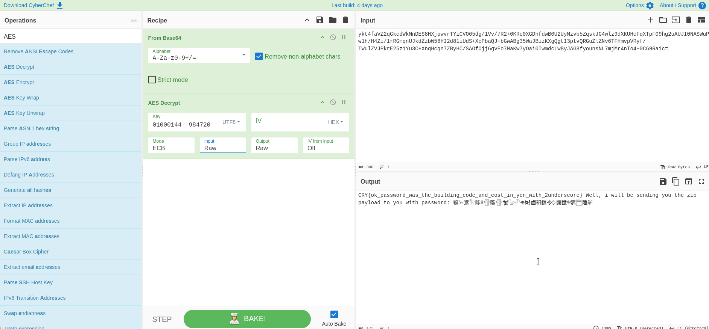

# Encoded Transmission

This challenge tied directly into the recon we did in *Riddled Code*. The intercepted chatter mentioned two specific numbers from the target's stay:
- Sanctuary Building Code: `01000144` (8 chars)
- Parking bleed in yen: `984720` (6 chars)

Standard AES-128 requires a 16-byte key. Since $8 + 6 = 14$ characters, joining them with a double underscore `__` gave the exact 16-byte key: `01000144__984720`.

The transmission payload was a 300-char Base64 blob decoding to 224 bytes (14 blocks of 16 bytes). Decrypting with AES-128-ECB and stripping PKCS#7 padding popped the plaintext right open.

### Solution via CyberChef
We can decode this directly using CyberChef with the `From Base64` and `AES Decrypt` operations:



### Python Solver (`solve.py`)
Alternatively, running the included `solve.py` script:

```bash
$ python3 solve.py
CRY{ok_password_was_the_building_code_and_cost_in_yen_with_2underscore} Well, i will be sending you the zip payload to you with password: ...
```

### Flag
```text
CRY{ok_password_was_the_building_code_and_cost_in_yen_with_2underscore}
```
