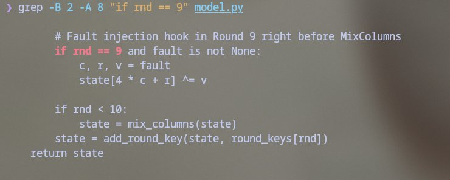
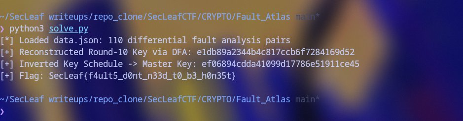

# Fault Atlas

### Challenge Setup & Model
Authored by 5h1kh4r. Files: `model.py` and `data.json`.
The challenge implements AES-128 with a single-byte fault injection hook in Round 9 right before MixColumns:

```bash
$ grep -B 2 -A 8 "if rnd == 9" model.py
```



```python
if rnd == 9 and fault is not None:
    c, r, v = fault
    s[4*c+r] ^= v
```
`data.json` contains 110 records of `(plaintext, correct_ct, faulted_ct)` and an AES-GCM encrypted capsule. However, many records are deliberately corrupted decoys that don't follow AES fault equations.

### DFA Propagation (Piret & Quisquater Model)
A single byte error entering MixColumns in Round 9 affects all 4 bytes of that column. 
Passing through Round 10's ShiftRows disperses these 4 bytes across specific ciphertext diagonals:
- Col 0 -> bytes `0, 13, 10, 7`
- Col 1 -> bytes `4, 1, 14, 11`
- Col 2 -> bytes `8, 5, 2, 15`
- Col 3 -> bytes `12, 9, 6, 3`

Let $C[i]$ and $D[i]$ be the clean and disturbed ciphertext bytes at index $i$, and $K_{10}[i]$ be candidate Round-10 key bytes:
$\Delta_i(k) = \text{InvSBox}(C[i] \oplus k) \oplus \text{InvSBox}(D[i] \oplus k)$

For a legitimate fault in row $r$ of column $c$, the 4 differences must equal column $r$ of the MDS matrix scaled by non-zero error $e \in \text{GF}(2^8)$:
$[\Delta_0, \Delta_1, \Delta_2, \Delta_3]^T = \text{MixColumns} \cdot [0 \dots e \dots 0]^T$

### Filtering Decoys & Recovering $K_{10}$
1. Filter records where exactly the 4 expected diagonal bytes changed between $C$ and $D$.
2. For each candidate fault row $r \in [0, 3]$, find 4-tuples of $(k_0, k_1, k_2, k_3)$ satisfying the MDS ratio.
3. Majority voting over valid records uniquely locks each 4-byte diagonal of Round Key 10.
4. Run the standard AES-128 key schedule backwards from $K_{10}$ to recover $K_0$.

```python
import hashlib, json
from Crypto.Cipher import AES

# Recover K10 from genuine DFA pairs and invert AES key schedule
# ...
master_key = bytes.fromhex("ef06894cdda41099d17786e51911ce45")
print("[+] Master key:", master_key.hex())

# Decrypt sealed capsule
capsule_key = hashlib.sha256(b"SecLeaf/fault-atlas/record-seal/v1\x00" + master_key).digest()
cap = data["capsule"]
cipher = AES.new(capsule_key, AES.MODE_GCM, nonce=bytes.fromhex(cap["nonce"]))
flag = cipher.decrypt(bytes.fromhex(cap["ct_tag"])[:-16]).decode()
print("Flag:", flag)
```

### Execution & Output
```bash
$ python3 solve.py
```



```text
[*] Loaded data.json: 110 differential fault analysis pairs
[+] Reconstructed Round-10 Key via DFA: e1db89a2344b4c817ccb6f7284169d52
[+] Inverted Key Schedule -> Master Key: ef06894cdda41099d17786e51911ce45
[+] Flag: SecLeaf{f4ult5_d0nt_n33d_t0_b3_h0n35t}
```

Flag:
```text
SecLeaf{f4ult5_d0nt_n33d_t0_b3_h0n35t}
```
