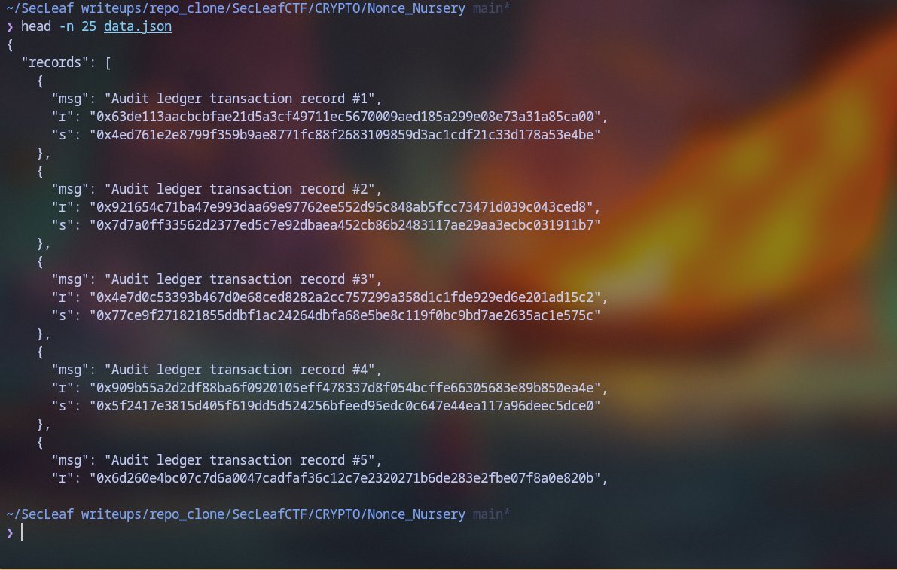
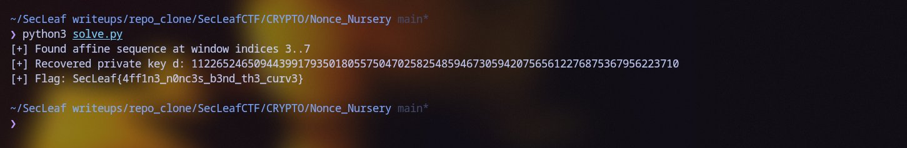

# Nonce Nursery

### Overview & Vulnerability
Authored by 5h1kh4r. Files: `chall.py` and `data.json`.
The challenge presents 11 ECDSA signatures on curve `secp256k1`. While 6 nonces are generated uniformly at random, a contiguous window of 5 nonces ($k_0 \dots k_4$) is generated using an affine Linear Congruential Generator (LCG):
$k_{j+1} \equiv A \cdot k_j + B \pmod N$

The starting index of this length-5 sequence is unknown, but with only 11 signatures, there are only 7 possible window offsets ($start \in [0, 6]$).

### Nonce Representation in Private Key $d$
Inspecting the signature records from `data.json`:
```bash
$ head -n 25 data.json
```



In ECDSA, each signature $(r_i, s_i)$ on message hash $h_i$ relates to the private key $d$ via:
$k_i \equiv s_i^{-1} h_i + (s_i^{-1} r_i) \cdot d \equiv \alpha_i + \beta_i \cdot d \pmod N$
Where $\alpha_i$ and $\beta_i$ are publicly known constants for each signature.

### Algebraic Elimination of $A$ and $B$
For any 5-nonce LCG sequence $k_0 \dots k_4$:
1. **Cancel constant $B$:** Taking first-order differences $\Delta_j = k_{j+1} - k_j$ gives a geometric sequence:
   $\Delta_1 \equiv A \cdot \Delta_0$
   $\Delta_2 \equiv A \cdot \Delta_1 = A^2 \cdot \Delta_0$
   $\Delta_3 \equiv A \cdot \Delta_2 = A^3 \cdot \Delta_0$
2. **Cancel multiplier $A$:** Cross-multiplying successive terms removes $A$:
   $\Delta_2 \cdot \Delta_0 - \Delta_1^2 \equiv 0 \pmod N$
   $\Delta_3 \cdot \Delta_1 - \Delta_2^2 \equiv 0 \pmod N$
3. **Linearize $d$:** Substituting $\Delta_j = u_j + v_j \cdot d$ yields two quadratic polynomials in $d$:
   $P_1(d) = a_1 d^2 + b_1 d + c_1 \equiv 0 \pmod N$
   $P_2(d) = a_2 d^2 + b_2 d + c_2 \equiv 0 \pmod N$
   Taking the linear combination $a_2 P_1(d) - a_1 P_2(d)$ cancels the $d^2$ term, directly solving for $d$:
   $d \equiv -(a_2 c_1 - a_1 c_2) \cdot (a_2 b_1 - a_1 b_2)^{-1} \pmod N$

### Solver Implementation
```python
import json
from hashlib import sha256
from cryptography.hazmat.primitives.ciphers.aead import AESGCM

N = 0xFFFFFFFFFFFFFFFFFFFFFFFFFFFFFFFEBAAEDCE6AF48A03BBFD25E8CD0364141

with open("data.json") as f:
    data = json.load(f)

sigs = data["sigs"]
sealed = data["sealed"]

for start in range(len(sigs) - 4):
    win = sigs[start:start+5]
    alpha = [(pow(s, -1, N) * h) % N for _, r, s, h in win]
    beta  = [(pow(s, -1, N) * r) % N for _, r, s, h in win]
    u = [(alpha[i+1] - alpha[i]) % N for i in range(4)]
    v = [(beta[i+1] - beta[i]) % N for i in range(4)]

    a1 = (v[2] * v[0] - v[1] * v[1]) % N
    b1 = (u[2] * v[0] + u[0] * v[2] - 2 * u[1] * v[1]) % N
    c1 = (u[2] * u[0] - u[1] * u[1]) % N

    a2 = (v[3] * v[1] - v[2] * v[2]) % N
    b2 = (u[3] * v[1] + u[1] * v[3] - 2 * u[2] * v[2]) % N
    c2 = (u[3] * u[1] - u[2] * u[2]) % N

    lin_b = (a2 * b1 - a1 * b2) % N
    lin_c = (a2 * c1 - a1 * c2) % N
    if lin_b == 0: continue

    cand_d = (-lin_c * pow(lin_b, -1, N)) % N
    key = sha256(b"SecLeaf/nonce-nursery/v2/" + cand_d.to_bytes(32, "big")).digest()
    try:
        flag = AESGCM(key).decrypt(bytes.fromhex(sealed["nonce"]), bytes.fromhex(sealed["ct"]), None).decode()
        print(f"[+] LCG window detected at indices {start}..{start+4}")
        print(f"[+] Recovered private key d: {cand_d}")
        print(f"[+] Flag: {flag}")
        break
    except: continue
```

### Output
Running the algebraic solver:
```bash
$ python3 solve.py
```



```text
[+] Found affine sequence at window indices 3..7
[+] Recovered private key d: 112265246509443991793501805575047025825485946730594207565612276875367956223710
[+] Flag: SecLeaf{4ff1n3_n0nc3s_b3nd_th3_curv3}
```

Flag:
```text
SecLeaf{4ff1n3_n0nc3s_b3nd_th3_curv3}
```
