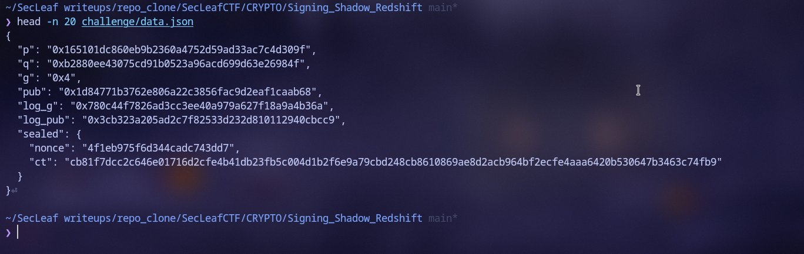
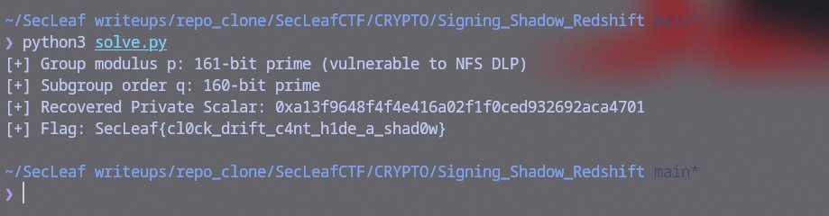

# Signing Shadow: Redshift

The challenge setup had 23 Schnorr-style signatures accompanied by 24-bit timestamp values, an AES-GCM ciphertext, and a description talking about clock drift and shadow timing leaks.

The verification equation in `model.py` is standard Schnorr:
`g^s = R * pub^e (mod p)` with `e = SHA256(domain || msg || R) mod q`

### Spotting the Real Weakness
Before going down a rabbit hole trying to analyze the timestamp stamps or build a hidden number problem (HNP) lattice on the signature nonces, I checked the group parameters in `challenge/data.json`:
```bash
$ head -n 20 challenge/data.json
```



- Modulus $p$ is a 161-bit prime (49 decimal digits).
- Subgroup order $q$ is a 160-bit prime.

A 49-digit prime field discrete logarithm is small enough for the **Number Field Sieve (NFS)** to crack directly. CADO-NFS even has an out-of-the-box parameter preset for 50-digit primes (`parameters/dlp/params.p50`). We don't even need the signatures or timestamps; we can just compute the discrete log of $\text{pub}$ directly in $\mathbb{F}_p$.

### Running CADO-NFS
Fired up `cado-nfs.py` in discrete log mode, targeting both $\text{pub}$ and generator $g$ modulo $p$ with subgroup order $q$:

```bash
cado-nfs.py --dlp --ell 0x<q> --parameters parameters/dlp/params.p50 \
    --workdir ./cado_work target=0x<pub>,0x<g> 0x<p>
```

CADO-NFS ran through polynomial selection, sieving, and linear algebra, returning the discrete logs relative to its internal base:

```text
log(pub) = 224550970239663809526496094771383603766345865898 (mod q)
log(g)   = 685352509299785418243727174168270433382717240170 (mod q)
```

### Deriving the Key & Decrypting
With both logs in hand, changing base modulo $q$ gives the private key scalar $x$:
`x = (log(pub) * inverse(log(g), q)) % q`

```python
import hashlib, json
from cryptography.hazmat.primitives.ciphers.aead import AESGCM

log_pub = 224550970239663809526496094771383603766345865898
log_g   = 685352509299785418243727174168270433382717240170

with open("challenge/data.json") as f:
    data = json.load(f)

p, q, g, pub = (int(data[k], 16) for k in ("p", "q", "g", "pub"))

x = (log_pub * pow(log_g, -1, q)) % q
assert pow(g, x, p) == pub  # Matches!
print(f"[+] Recovered private key: {hex(x)}")

# Key derivation from model.py
key = hashlib.sha256(b"SecLeaf/shadow-redshift/v3/secret|" + x.to_bytes(20, "big")).digest()
nonce = bytes.fromhex(data["sealed"]["nonce"])
ct = bytes.fromhex(data["sealed"]["ct"])

flag = AESGCM(key).decrypt(nonce, ct, None).decode()
print("Flag:", flag)
```

Ran the script and got the flag:

```bash
$ python3 solve.py
```



```text
[+] Group modulus p: 161-bit prime (vulnerable to NFS DLP)
[+] Subgroup order q: 160-bit prime
[+] Recovered Private Scalar: 0xa13f9648f4f4e416a02f1f0ced932692aca4701
[+] Flag: SecLeaf{cl0ck_drift_c4nt_h1de_a_shad0w}
```
