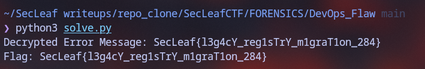

# DevOps Flaw

The challenge handed us an encrypted 7-Zip file, `Archive.7z`. Header encryption was enabled, so you couldn't even see the filenames without the key.

### Cracking the 7z Header
Dumped the archive hash with `7z2john` and ran it against `rockyou.txt` using Hashcat:

```bash
$ 7z2john Archive.7z > archive.hash
$ cut -d: -f2- archive.hash > hashcat.txt
$ hashcat -m 11600 -a 0 hashcat.txt /usr/share/wordlists/rockyou.txt -O
```

Hashcat cracked it pretty quickly: `299792458rocks`.

Extracting the 7z gave an inner `Archive.zip`, which unpacked into a 2GB raw disk image called `challenge`.

### Carving the Ext4 Filesystem
Checked the MBR partition table with `fdisk`:

```bash
$ fdisk -l challenge
Device     Boot Start     End Sectors Size Id Type
challenge1       2048 4194303 4192256   2G 83 Linux
```

Sector 2048 at 512 bytes/sector starts at offset `1,048,576` (1MB). Carved out the partition using `dd`:

```bash
$ dd if=challenge of=partition.img bs=1M skip=1 status=none
```

Instead of mounting it as root, dumped everything using `debugfs`:

```bash
$ mkdir files && debugfs -R 'rdump / files' partition.img
```

### Hunting for the Leak
Poked around the extracted files. Inside `acme-infrastructure`, grepped for key material:

```bash
$ grep -rn "KEY_" files/acme-infrastructure/
files/acme-infrastructure/.env.example:6:DB_PASSWORD=KEY_15_00f
```

Then checked the deployment logs in `acme-infrastructure/logs/deploy-2026-09-18.log`:

```text
[INFO] Starting staging deployment
[INFO] Target release: inventory-api:1.8.3
[ERROR]	SjcCenftl<g;cV_}eh1|T}YPm>g}a[1`nP274r
[WARN] Legacy registry reference detected
[ERROR] Migration ticket INFRA-284 is still open
```

That error line looked garbled, but looking at `SjcCenft...` against the standard flag header `SecLeaf{...`:
- `S` ^ `S` = `0x00`
- `j` ^ `e` = `0x0F` (15 decimal)
- `c` ^ `c` = `0x00`
- `C` ^ `L` = `0x0F`
- `e` ^ `e` = `0x00`
- `n` ^ `a` = `0x0F`

Every odd character was XORed with `0x0F` (matching the hint `KEY_15_00f` in `.env.example`), while even characters were untouched.


### Reversing the XOR
Ran a quick python one-liner or `solve.py`:

```bash
$ python3 solve.py
```



Flag:
```text
SecLeaf{l3g4cY_reg1sTrY_m1graT1on_284}
```
