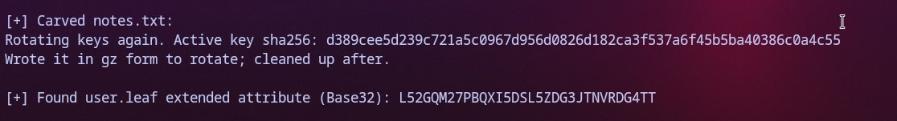
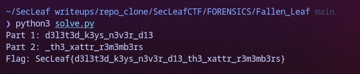

# Fallen Leaf

Extracted the raw ext4 image `leafdisk.img` from `leafdisk.img.xz`. 

Instead of mounting it (which can mess with timestamps/inodes), poked inside directly with `debugfs`:

```bash
$ debugfs -R 'cat /home/leaf/.bash_history' leafdisk.img
for f in k_*.txt; do gzip -N $f; done
openssl enc -aes-256-cbc -pbkdf2 -iter 100000 -salt -in harvest.txt -out Documents/harvest.enc -pass file:.cache/k_active
shred -u harvest.txt
rm -f .cache/k_*
history -c
```

The user shredded `harvest.txt` and deleted the key files. But they left a note in `Documents/notes.txt`:
```bash
$ debugfs -R 'cat /home/leaf/Documents/notes.txt' leafdisk.img
Rotating keys again. Active key is the one whose sha256 is
d389cee5d239c721a5c0967d956d0826d182ca3f537a6f45b5ba40386c0a4c55
```

Ran `lsdel` in debugfs to see deleted inodes:
```bash
$ debugfs -R 'lsdel' leafdisk.img
# Found 4 deleted inodes: 24, 25, 26, 27
```

Dumped and un-gzipped all four:
```bash
$ for i in 24 25 26 27; do
    debugfs -R "dump <$i> $i.gz" leafdisk.img
    gzip -dc "$i.gz"
  done
leafkey:Gr33n-Sapl1ng-77
leafkey:R00t-B4ll-Aut0mn-12
leafkey:Phl03m-X7lem-Fl0w-90
leafkey:C4mb1um-R1ng-2024
```

Hashed them — `Phl03m-X7lem-Fl0w-90` matched the SHA256 in `notes.txt`. 

Dumped `harvest.enc` and decrypted it with OpenSSL:
```bash
$ debugfs -R 'dump /home/leaf/Documents/harvest.enc harvest.enc' leafdisk.img
$ openssl enc -d -aes-256-cbc -pbkdf2 -iter 100000 -in harvest.enc -pass pass:Phl03m-X7lem-Fl0w-90
```

Decrypted content:
```text
== harvest log ==
FLAG=SecLeaf{d3c0y_th3_tr33_h4s_n0_r00ts}
Part one of the real flag: d3l3t3d_k3ys_n3v3r_d13
Part two travels with the note, not inside it. (base32, attribute 'leaf')
```

First flag was a decoy. Real flag is split into two:
- Part 1: `d3l3t3d_k3ys_n3v3r_d13`
- Part 2: stored in the `leaf` extended attribute on `notes.txt`.

Dumped the xattr:
```bash
$ debugfs -R 'ea_list /home/leaf/Documents/notes.txt' leafdisk.img
user.leaf = "L52GQM27PBQXI5DSL5ZDG3JTNVRDG4TT"

$ echo -n "L52GQM27PBQXI5DSL5ZDG3JTNVRDG4TT" | base32 -d
_th3_xattr_r3m3mb3rs
```



Running `solve.py` to combine both halves:

```bash
$ python3 solve.py
```



Combined both halves:
```text
SecLeaf{d3l3t3d_k3ys_n3v3r_d13_th3_xattr_r3m3mb3rs}
```
