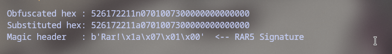
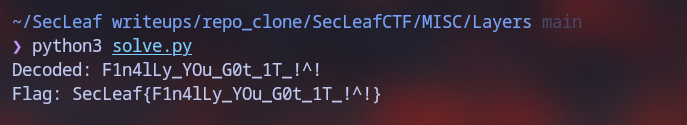

# Layers

Got a file named `Binary_Data` filled with 4,320 bits (0s and 1s). 

Divided by 8 gives 540 bytes. Converting every 8 bits to ASCII revealed a weird string starting with:
`526172211n0701007300...`

Looked like hex right away, except `n` through `s` were sitting where `a` through `f` should be (a simple Caesar shift on the hex alphabet). Replaced `nopqrs` -> `abcdef` and checked the first few bytes: `52 61 72 21 1a 07 01 00`. That's the classic **RAR5** magic header (`Rar!\x1a\x07\x01\x00`).

### Step 1: Uncovering the RAR5 Header


Dumped the bytes into `layer.rar`. The archive had encrypted headers, so listing files prompted for a password. Dumped the hash with `rar2john` and ran it against `rockyou.txt`:

```bash
$ rar2john layer.rar > rar.hash
$ john --wordlist=/usr/share/wordlists/rockyou.txt rar.hash
Loaded 1 password hash (rar5, RAR5 [PBKDF2-SHA256 128/128 AVX 4x])
stormstorm       (layer.rar)
```

Password cracked almost instantly: `stormstorm`.

Unpacked the archive:
```bash
$ 7z x -pstormstorm layer.rar
$ cat Text
u`?c={J0*~F0v_E0`%0P/P
```

The output string has characters across the full printable ASCII range (`!` to `~`), matching standard **ROT47**.

### Step 2: Solver Execution & Flag Recovery
Running `solve.py` to decode the ROT47 payload:



### Flag
```text
SecLeaf{F1n4lLy_YOu_G0t_1T_!^!}
```
