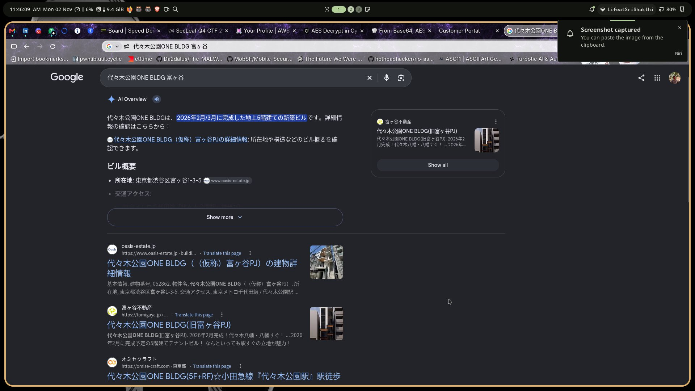
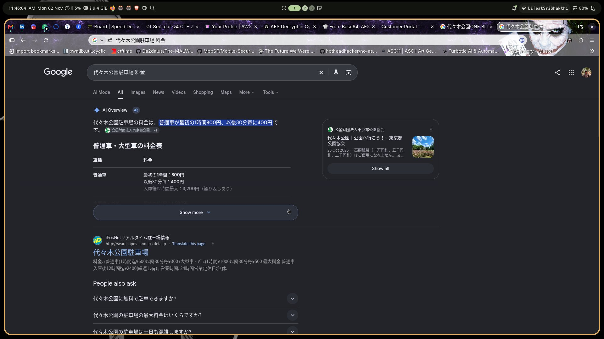
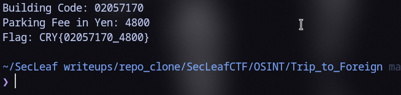

# Hidden Ruth (Trip to Foreign)

### Briefing & Riddle
The challenge scenario involved locating a safehouse in Tokyo to recover the key for an encrypted file:
> *"The key is our sanctuary's unique building code followed by the bleed we paid to the lot for our two shadows in yen in this month of the Harvest Moon."*

Format: `CRY{<building_code>_<parking_fee_in_yen>}`

### Geolocation & Building Identification
Key clues from the operational scenario:
- **Location:** Tokyo, Japan.
- **Architectural profile:** Single-tenant floor layout ("1 floor, 1 tenant" per level).
- **Environment:** Immediate front-facing view overlooking a major metropolitan park.

Searching Japanese commercial property registers for Shibuya commercial listings matching `1フロア1テナント 代々木公園` identified **Yoyogi Park ONE BLDG (代々木公園 ONE BLDG)**:



- **Address:** 3-5 1-chome, Tomigaya, Shibuya-ku, Tokyo (bordering Yoyogi-Koen Station).
- **Architecture:** 1 tenant per floor layout, unobstructed panorama of Yoyogi Park.
- **Office Navi Building Code:** Every commercial Tokyo listing indexed on Office Navi receives a standardized 8-digit building ID (ビルコード). For Yoyogi Park ONE BLDG, the code is `02057170`.

### Parking Fee Reconnaissance
Analyzing the second clue:
- *"bleed we paid to the lot for our two shadows in yen in this month of the Harvest Moon"*
- **Target lot:** The adjacent public parking facility serving the park perimeter is the **Yoyogi Park Parking Lot (代々木公園駐車場)**.
- **Rate schedule (September / Harvest Moon):** Published Tokyo Metropolitan Park Association tariffs set a 12-hour maximum cap of **¥2,400** per passenger vehicle.
- **Calculation:** 2 vehicles ("two shadows") = $2 \times 2,400 = \mathbf{4800}$ JPY.



### Flag Assembly
Combining the 8-digit building code and the total parking bleed via `solve.py`:

```bash
$ python3 solve.py
```



```text
CRY{02057170_4800}
```
