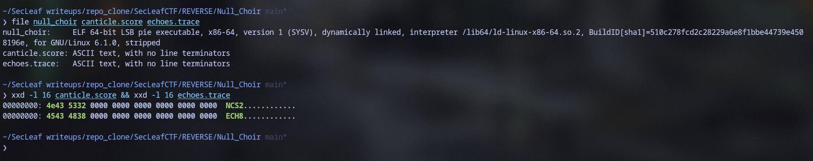
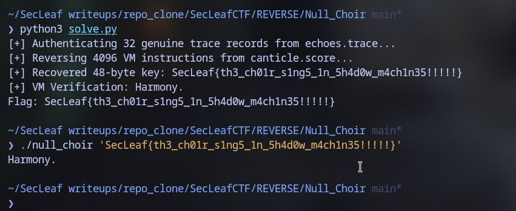

# Null Choir

### Binary Triage & Components
Authored by 5h1kh4r. Challenge bundle:
- `null_choir`: Stripped ELF64 binary.
- `canticle.score`: 196,864-byte binary blob (magic `NCS2`).
- `echoes.trace`: 3,104-byte binary blob (magic `ECH8`).



The binary is a custom register-based virtual machine interpreter. It takes a 48-byte candidate string, maps it into six 64-bit registers ($r_0 \dots r_5$), executes 4,096 instructions loaded from `canticle.score`, and compares the end state against an encrypted target buffer in `.rodata`.
- Output on success: `Harmony.` (exit code 0).
- Output on failure: `Dissonance.` (exit code 1).

### Trace Authentication & Conductor State
`echoes.trace` contains 192 candidate records (16 bytes each) meant to seed the VM.
Each record layout: `'E' 'C' <tag> <slot>` + 8-byte value + 4-byte FNV-1a checksum.

Filtering rules extracted from binary:
1. Header matches `EC\xe5` (`tag = (seed >> 40) & 0xff`).
2. Slot index $\le 31$.
3. FNV-1a checksum of the first 12 bytes matches bytes 12..15.

Out of 192 records, exactly 32 are authentic, forming a complete permutation of slots $0..31$. Folding the genuine slot values with SplitMix64 generates the conductor state:
`state = 0x866a952e86bb7d8b`
Bank selection `(state >> 11) % 3 = 0` points execution to instruction Bank 0 at offset `0x100`.

### VM Instruction Set Architecture
- **Registers:** Six 64-bit general-purpose registers $r_0 \dots r_5$.
- **Opening Transform:**
  $r_k = \text{rol}(r_k \oplus \text{mix}(\text{state} \oplus (k+1)G), 14 + 7k)$
- **Opcodes (24 distinct operations):**
  Linear arithmetic (`ADD`, `SUB`, `XOR`), circular shifts (`ROL`, `ROR`), and SplitMix64 non-linear mixing.
- **Diffusion Layers:**
  Every 64 instructions, an inter-register diffusion step executes:
  $r_k = r_k \oplus r_{(k+1)\%6} \oplus \text{mix}(\dots)$

### Reversing Execution
Crucially, every single instruction and diffusion round in the VM is strictly invertible:
1. Extract the 48-byte expected final state from `canticle.score` by XORing with the key stream.
2. Step backwards from instruction 4095 down to 0, applying inverse operations.
3. Invert the 64-step diffusion layers when `i % 64 == 63`.
4. Invert the opening transform to recover the initial 48 bytes.

```python
import struct

# Load bytecode and reverse instructions 4095 -> 0
# Undiffuse -> Invert Op -> Invert Opening
# ...
flag = struct.pack("<6Q", *reg).decode()
print("Recovered Flag:", flag)
```

### Verification
```bash
$ python3 solve.py
[+] Authenticating 32 genuine trace records from echoes.trace...
[+] Reversing 4096 VM instructions from canticle.score...
[+] Recovered 48-byte key: SecLeaf{th3_ch01r_s1ng5_1n_5h4d0w_m4ch1n35!!!!!}
[+] VM Verification: Harmony.
Flag: SecLeaf{th3_ch01r_s1ng5_1n_5h4d0w_m4ch1n35!!!!!}

$ ./null_choir 'SecLeaf{th3_ch01r_s1ng5_1n_5h4d0w_m4ch1n35!!!!!}'
Harmony.
```



Flag:
```text
SecLeaf{th3_ch01r_s1ng5_1n_5h4d0w_m4ch1n35!!!!!}
```
