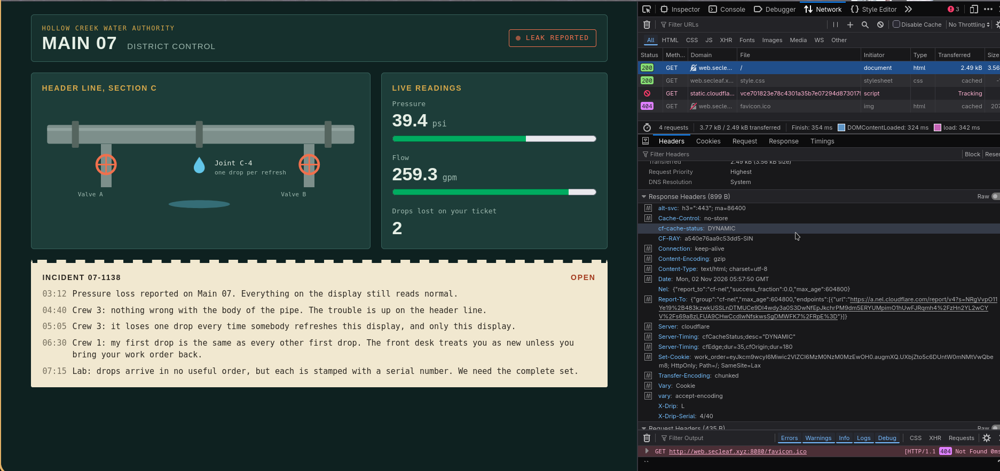
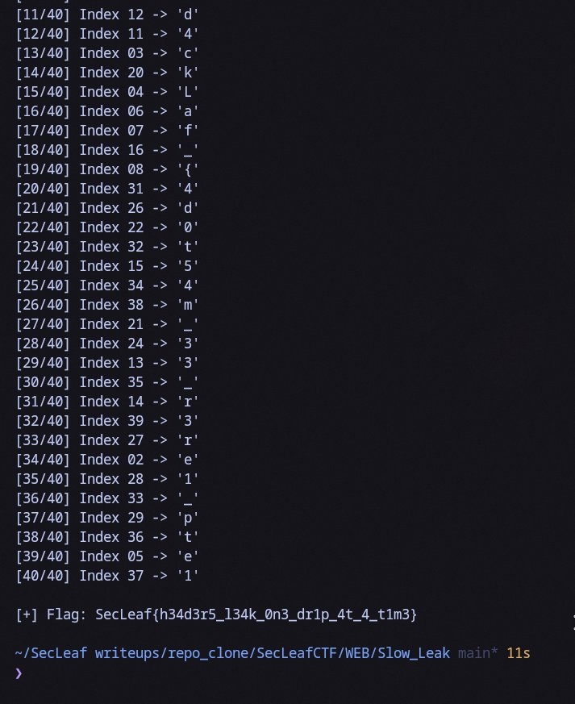

# Slow Leak

Hit `http://web.secleaf.xyz:8080/` with curl and checked the response headers:

```bash
$ curl -i http://web.secleaf.xyz:8080/
HTTP/1.1 200 OK
Set-Cookie: work_order=s%3AeyJpZCI6IjYxOWM1Z...; Path=/; HttpOnly
X-Drip: S
X-Drip-Serial: 1/40
```

Notice the two custom headers right away:
- `X-Drip: S`
- `X-Drip-Serial: 1/40`



It's leaking the flag one character at a time across 40 total indices. Sending requests with the same `work_order` cookie yielded random positions (`14/40`, `27/40`, `3/40`, etc.). 

Wrote a quick dirty python script using `requests.Session()` to loop until all 40 slots were filled:

```python
import re, requests

TARGET = "http://web.secleaf.xyz:8080/"
s = requests.Session()
drops = {}

while len(drops) < 40:
    r = s.get(TARGET)
    char = r.headers.get("X-Drip")
    serial = r.headers.get("X-Drip-Serial", "")
    m = re.match(r"(\d+)/40", serial)
    if char and m:
        idx = int(m.group(1))
        drops[idx] = char

flag = "".join(drops[i] for i in range(1, 41))
print("Flag:", flag)
```

Ran the script, grabbed all 40 drops, and stitched the flag:

```bash
$ python3 solve.py
```



```text
SecLeaf{h34d3r5_l34k_0n3_dr1p_4t_4_t1m3}
```
